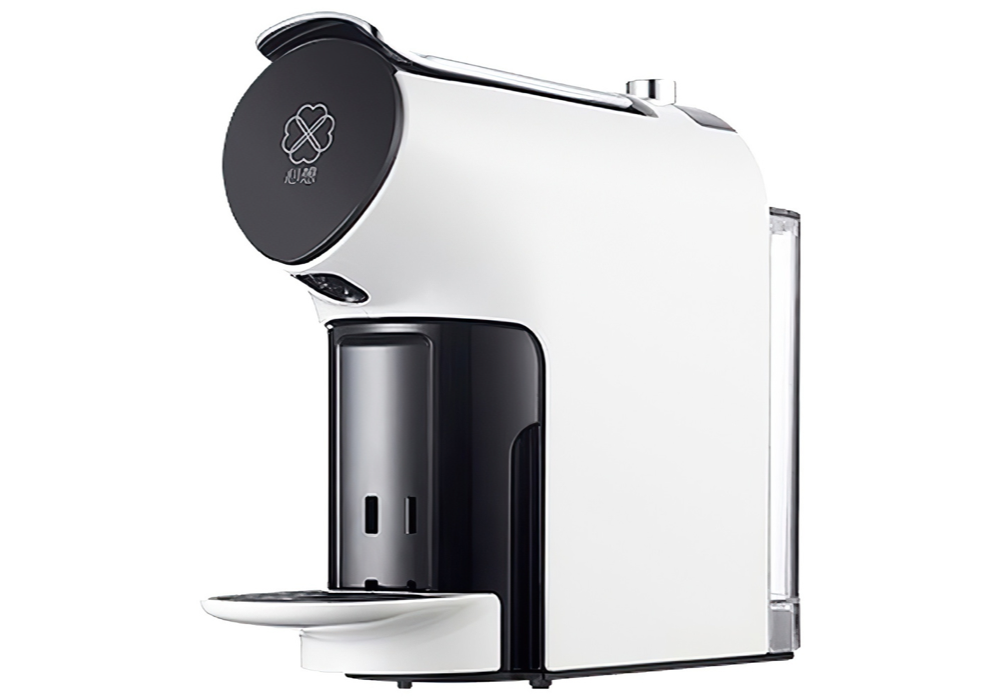

# Scishare Coffee for Homey

[Русская версия](#русская-версия) · [English version](#english-version)

---

<p align="center">
  
</p>

## Русская версия

### Очистка от накипи (0.1.6)

Перед запуском подготовьте машину по инструкции производителя и поставьте ёмкость для слива. Кнопка **Очистка от накипи** и Flow-действие **Запустить очистку от накипи** включают спящую машину и отправляют `Machine_Descaling` один раз. При потере ответа повторного запуска нет. Завершение подтверждается только переходом 6 → 5 и вызывает отдельный триггер **Очистка от накипи завершена**, а не уведомление о напитке. Наблюдение ограничено 15 минутами; отключение питания или нехватка воды прерывают отслеживание без сигнала готовности. Автоматическая остановка очистки не реализована.

### Descaling (0.1.6)

Prepare the machine according to its manual and place a drain container first. The **Descaling** device button and **Start descaling** Flow action wake the machine and send `Machine_Descaling` once, without retrying a lost acknowledgement. Only the observed 6 → 5 transition fires the separate **Descaling finished** trigger. Monitoring lasts up to 15 minutes; power-off or a water fault cancels tracking without a completion event. Automatic cancellation of the machine's cleaning cycle is not implemented.

Локальное управление кофемашиной **Scishare Smart Capsule Coffee Machine S1102** из Homey Pro. Приложение работает напрямую с кофемашиной по локальной сети через протокол MiIO UDP: после добавления не требует Xiaomi Cloud или постоянного доступа в интернет.

### Возможности

- Включение, выключение и обновление статуса кофемашины.
- Приготовление эспрессо, американо и подача горячей воды из Flow.
- Быстрые кнопки в карточке устройства: **Эспрессо**, **Американо**, **Горячая вода**.
- Индивидуальные объём и температура напитков в **Advanced Settings** устройства.
- Настраиваемые фразы готовности для эспрессо, американо и горячей воды в **Advanced Settings**. Пустое поле сохраняет стандартную фразу на языке Homey; текст передаётся в Flow тегом «Сообщение о готовности» для голоса и push.
- При потере подтверждения отправленной команды приложение продолжает отслеживание без повторного запуска приготовления. Ожидание завершения — до пяти минут; после потери подтверждения требуется наблюдаемый переход приготовления в готовность.
- Обновлённые контурные SVG-иконки кофемашины.
- Автоматическое включение и нагрев перед подачей напитка или воды.
- Русский и английский интерфейс приложения, Flow-карточек, настроек и экрана добавления.
- Триггеры Flow: «В кофемашине закончилась вода» и «Напиток или горячая вода готовы».
- IP-адрес и MiIO token вводятся только при добавлении устройства либо в его настройках и не хранятся в этом репозитории.

### Что потребуется

- Homey Pro с доступом к Developer Tools / Homey CLI.
- Кофемашина Scishare S1102 в той же локальной сети, что и Homey.
- Закреплённый в роутере IPv4-адрес кофемашины.
- 32-символьный MiIO token кофемашины.

### Установка на Homey Pro

1. Установите Node.js 18 или новее и Homey CLI:

   ```bash
   npm install -g homey
   ```

2. Склонируйте репозиторий и установите зависимость для разработки:

   ```bash
   git clone https://github.com/edsallo/homey-scishare-coffee.git
   cd homey-scishare-coffee
   npm install
   ```

3. Войдите в Homey CLI, проверьте и установите приложение:

   ```bash
   homey login
   homey app validate
   homey app install
   ```

4. В Homey добавьте устройство: **Scishare Coffee → Кофемашина Scishare S1102**. Укажите закреплённый IPv4-адрес и MiIO token.

После добавления откройте **Advanced Settings** устройства, чтобы задать параметры трёх быстрых кнопок.

> Не используйте `homey app install --clean`: команда удаляет уже добавленные устройства.

### Безопасность

Кофемашина подаёт горячую воду. Перед запуском Flow или быстрой кнопки всегда поставьте подходящую чашку под носик. Статус от кофемашины не заменяет личный контроль процесса.

---

## English version

Local LAN control of the **Scishare Smart Capsule Coffee Machine S1102** from Homey Pro. The app communicates directly with the machine over the local MiIO UDP protocol; after pairing, it does not require Xiaomi Cloud or persistent internet access.

### Features

- Power control and status refresh.
- Brew espresso, americano, or dispense hot water from Flow.
- Three quick buttons in the device card: **Espresso**, **Americano**, and **Hot water**.
- Per-drink volume and temperature settings in the device's **Advanced Settings**.
- Custom ready messages for espresso, americano and hot water in **Advanced Settings**. Empty fields use the default message in Homey's language. Flow receives the text through the Ready message token for speech and push notifications.
- A lost acknowledgement of a sent drink command keeps completion monitoring active without sending the drink command again. Monitoring lasts up to five minutes; uncertain commands require an observed preparation-to-ready transition.
- Updated outline SVG coffee machine icons.
- Automatic power-on and preheating before dispensing.
- Russian and English translations for the app interface, Flow cards, settings, and pairing screen.
- Flow triggers for an empty water tank and for a confirmed completed operation.
- The local IP address and MiIO token are entered only during pairing or in device settings; they are never stored in this repository.

### Requirements

- Homey Pro with Developer Tools / Homey CLI access.
- A Scishare S1102 on the same local network as Homey.
- A reserved local IPv4 address for the machine.
- The machine's 32-character MiIO token.

### Install on Homey Pro

1. Install Node.js 18 or newer and the Homey CLI:

   ```bash
   npm install -g homey
   ```

2. Clone this repository and install the development dependency:

   ```bash
   git clone https://github.com/edsallo/homey-scishare-coffee.git
   cd homey-scishare-coffee
   npm install
   ```

3. Authenticate the Homey CLI, validate, and install the app:

   ```bash
   homey login
   homey app validate
   homey app install
   ```

4. In Homey, add **Scishare Coffee → Coffee machine Scishare S1102** and enter the reserved IPv4 address and MiIO token.

After pairing, open the device's **Advanced Settings** to configure the three quick buttons.

> Do not use `homey app install --clean`: it removes existing paired devices.

### Safety

The appliance dispenses hot water. Always ensure a suitable cup is under the spout before starting a Flow or using a quick button. Machine status reporting does not replace supervision.

## License

[MIT](LICENSE)
